<!--
  Hi, you're reading the source of my profile. Feel free to borrow ideas.
  Portfolio: https://portfolio-beige-six-oxsb0gllne.vercel.app/
-->

  

  
  
  
  

B.Tech CSE &nbsp;·&nbsp; ITER, Siksha 'O' Anusandhan &nbsp;·&nbsp; Class of 2029

<picture>
  <source media="(prefers-color-scheme: dark)" srcset="assets/about-heading-dark.svg" />
  
</picture>

  I learn how operating systems work by building the parts most people never see: shells, process managers and state engines. I also run and maintain my own Linux setup. Lately that has grown into backends: a modular C++ server framework, an API over SQLite, and a Postgres rewards platform where every table sits behind row-level security.

| Building | Studying | Daily driver | Practising |
| :-: | :-: | :-: | :-: |
| CentralPlatform, a C++23 server framework | B.Tech CSE Class of 2029 | Arch / EndeavourOS Hyprland · Neovim | DSA in public on LeetCode |

 

<picture>
  <source media="(prefers-color-scheme: dark)" srcset="assets/heading-work-dark.svg" />
  
</picture>

<table>
  <tr>
    <td width="50%" valign="top">
      
       
      <b><a href="https://github.com/FzAlpha/loyalty-app">Rewards Platform</a></b> &nbsp;BACKEND · CLIENT WORK
       
      Backend for a loyalty app on Postgres. It has 14 schema modules behind deny-by-default row-level security, 17 pgTAP test files in CI and 9 Edge Functions.
       
      <code>PostgreSQL</code> <code>Supabase</code> <code>TypeScript</code> <code>pgTAP</code>
    </td>
    <td width="50%" valign="top">
      
       
      <b><a href="https://github.com/FzAlpha/algo-vault">AlgoVault</a></b> &nbsp;FULL STACK
       
      A vault for coding-practice solutions: a C++ HTTP server over SQLite with 14 REST endpoints. It syncs LeetCode stats and draws a practice heatmap.
       
      <code>C++17</code> <code>SQLite</code> <code>REST</code> <code>JavaScript</code>
    </td>
  </tr>
  <tr>
    <td width="50%" valign="top">
      
       
      <b><a href="https://github.com/FzAlpha/api_network_system">CentralPlatform</a></b> &nbsp;C++ BACKEND
       
      A modular C++23 server framework. Modules start in order and tear down in reverse, and errors are returned as <code>std::expected</code> values. Early in development.
       
      <code>C++23</code> <code>Crow</code> <code>SQLite</code> <code>Docker</code>
    </td>
    <td width="50%" valign="top">
      
       
      <b><a href="https://github.com/FzAlpha/custom-linux-shell">NovaShell</a></b> &nbsp;OS INTERNALS
       
      A small Unix shell in modern C++ with fork / exec, <code>dup2</code> redirection, and Ctrl+C that stops the child, not the shell.
       
      <code>C++23</code> <code>POSIX</code> <code>Signals</code>
    </td>
  </tr>
  <tr>
    <td width="50%" valign="top">
      
       
      <b><a href="https://website-checker-lmdx.vercel.app/">Velvané</a></b> &nbsp;WEB DESIGN
       
      A studio showcase of ten complete websites in ten styles, from minimal to immersive 3D, plus three sites that blend them.
       
      <code>React</code> <code>TypeScript</code> <code>Canvas</code> <code>Motion</code>
    </td>
    <td width="50%" valign="top">
      
       
      <b>Manufacturer Catalogue</b> &nbsp;WEB · CLIENT WORK (PRIVATE)
       
      A B2B catalogue for a garment and uniform manufacturer, with a quote request form that emails the sales team.
       
      <code>Next.js</code> <code>TypeScript</code> <code>Tailwind</code> <code>Nodemailer</code>
    </td>
  </tr>
</table>

Earlier work: <a href="https://github.com/FzAlpha/log-Manager">log-Manager</a> · <a href="https://github.com/FzAlpha/chat-program">chat-program</a>

 

<picture>
  <source media="(prefers-color-scheme: dark)" srcset="assets/heading-toolbox-dark.svg" />
  
</picture>

LANGUAGES 
  

BACKEND & WEB 
  

SYSTEMS & TOOLS 
  

Also: Lua · FastAPI · Hyprland · GDB · POSIX syscalls · row-level security

 

<picture>
  <source media="(prefers-color-scheme: dark)" srcset="assets/heading-practice-dark.svg" />
  
</picture>

  
  

  

 

<picture>
  <source media="(prefers-color-scheme: dark)" srcset="assets/heading-contact-dark.svg" />
  
</picture>

> [!TIP]
> **Hiring, or have an interesting problem?** I'll bring the pointers, you bring the problem.
> The fastest way to reach me is [email](mailto:hritabratabardhan13579@gmail.com). You can also find me on [LinkedIn](https://www.linkedin.com/in/hritabrata-bardhan-12b498365/), on Discord as `fz_alpha_1`, or at [my portfolio](https://portfolio-beige-six-oxsb0gllne.vercel.app/).

